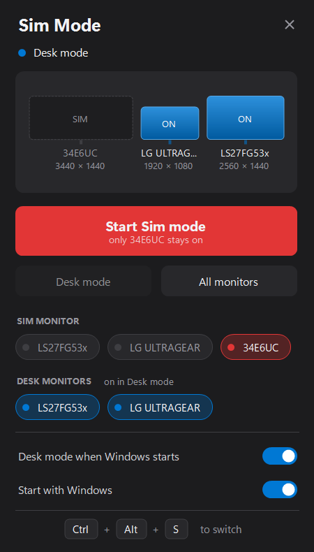
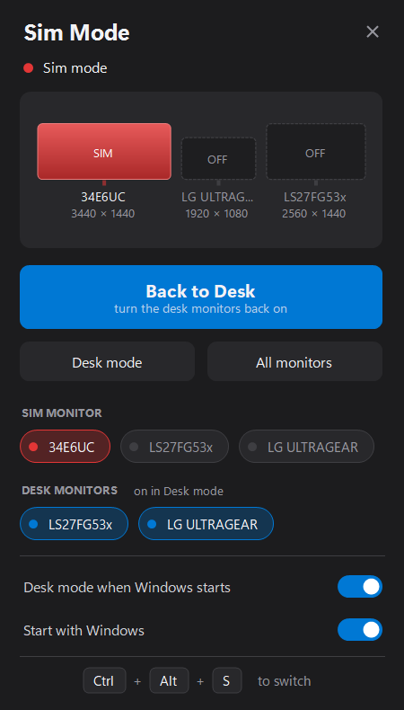

# Sim Mode

One hotkey to flip a multi-monitor Windows PC between the **sim-racing monitor(s) on their own** and the **normal desk monitors**. In Sim mode the other screens are turned off, so the taskbar, every new window and every notification lands on the sim monitors.

<p>
  
  
</p>

## Use

- **Ctrl+Alt+S** – toggle Sim mode / Desk mode from anywhere
- **Left‑click** the tray icon – open the panel
- **Middle‑click** the tray icon – toggle
- **Right‑click** the tray icon – Open, Sim mode, Desk mode, All monitors, Exit
- Starting `SimMode.exe` again while it runs opens the panel

| Mode | Monitors on |
|---|---|
| Sim mode | only the sim monitors (one, or several for a triple-screen rig) |
| Desk mode | the desk monitors (default: every monitor except the sim monitors) |
| All monitors | everything, in the layout Windows saved |

In the panel, pick the sim monitors and the desk monitors by clicking their chips (at least one of each). With three or more sim monitors the middle one becomes the primary display in Sim mode, unless the current primary is already one of them. A sim monitor that is unplugged is skipped. Tray icon colour: **red** = Sim mode, **blue** = Desk mode, **grey** = anything else, **amber** = switching.

## How it works

It uses the Windows display configuration API (`QueryDisplayConfig` / `SetDisplayConfig`). Monitors are matched by their EDID name, so Windows renumbering displays does not matter.

Sim and Desk mode are applied without saving to Windows' display settings, so the layout Windows stored with every monitor on stays intact and is always what comes back. Because of that Windows turns every monitor on again at boot; with **Desk mode when Windows starts** (on by default) the app switches to Desk mode a few seconds after login.

Settings are stored in `HKCU\Software\SimMode`. **Start with Windows** adds the exe to `HKCU\...\CurrentVersion\Run`. Only one copy runs at a time.

## Build

Windows only. No SDK needed: `build.bat` uses the .NET Framework compiler that ships with Windows.

```
build.bat
```

Exit the running app (tray menu → Exit) before rebuilding, since the exe is locked while it runs.

The default sim monitor name is `34E6UC` (`DefaultSimMonitor` in `SimMode.cs`); choose yours in the panel instead of editing it. Settings from older versions (`SimMonitor`) are picked up automatically.
